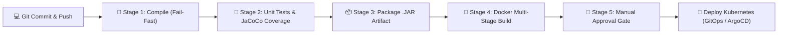

# Laboratório Prático de CI/CD: Jenkins LTS (Java 21) & Pipeline Declarativa

Este laboratório faz parte da esteira de preparação e capacitação Senior/Staff Backend. Aqui demonstramos na prática como funciona uma esteira corporativa moderna de **Integração Contínua (CI)** e **Entrega Contínua (CD)** para microsserviços Spring Boot 3 + Java 21.

---

## 🏗️ 1. Arquitetura da Pipeline de Produção

Em empresas modernas de alta maturidade (Nubank, Itaú, Mercado Livre, iFood, etc.), nenhum código vai para produção sem passar por uma esteira automatizada com **Quality Gates** rigorosos.



### Por que cada estágio é estruturado desta forma?

1. **Stage 1: Compile (Princípio do Fail-Fast):**
   - Valida se o código compila sintaticamente com o JDK 21.
   - Se houver qualquer quebra de tipo ou dependência quebrada, a pipeline aborta em menos de 15 segundos, poupando minutos de CPU dos agentes e dando feedback imediato ao desenvolvedor.
2. **Stage 2: Unit Tests & JaCoCo (Quality Gates):**
   - Executa testes unitários com JUnit 5 e Mockito.
   - O plugin do JaCoCo calcula a cobertura de linhas e ramificações (*branch coverage*).
   - Em produção, integra-se com o **SonarQube**: se a cobertura for `< 80%` ou houver novas vulnerabilidades (*security hotspots*), a pipeline falha e bloqueia o Pull Request.
3. **Stage 3: Package Artifact (Imutabilidade):**
   - Gera o Fat JAR executável do Spring Boot.
   - O artefato é imutável: o mesmo arquivo `.jar` testado no CI será promovido entre ambientes (Dev -> Staging -> Prod), garantindo reprodutibilidade.
4. **Stage 4: Docker Multi-Stage Build:**
   - Cria uma imagem container leve com base distroless ou Alpine (`eclipse-temurin:21-jre-alpine`).
   - Não embute ferramentas de compilação (Maven/Gradle) na imagem final, reduzindo a superfície de ataque CVE e o tamanho da imagem de centenas de MB para menos de 100 MB.
5. **Stage 5: Manual Approval Gate (Continuous Delivery vs Deployment):**
   - **Continuous Delivery:** A esteira automatiza tudo até a geração da imagem testada e aprovada, mas a publicação em Produção exige o clique de aprovação de um Tech Lead / Release Manager.
   - **Continuous Deployment:** Aprovado nos testes, o deploy acontece automaticamente sem intervenção humana (geralmente combinado com Canary Deployments e análise de métricas no Prometheus/Datadog).

---

## 🚀 2. Como Rodar e Testar na Prática

O servidor Jenkins já está em execução no seu Docker local mapeado para a porta **8084**.

### Passo 1: Acessar a Interface Web do Jenkins
Abra o seu navegador e acesse:
👉 **[http://localhost:8084](http://localhost:8084)**

### Passo 2: Desbloquear o Jenkins (Unlock Jenkins)
Na tela "Unlock Jenkins", cole a chave de administrador inicial gerada pelo container:
```text
c98f7a5998ce4a77aa30d7a0a237cc49
```
Clique em **Continue**.

### Passo 3: Escolher os Plugins Iniciais
- Você pode clicar em **"Install suggested plugins"** (instala Git, Pipeline, etc.).
- O Jenkins baixará e instalará os plugins padrão. Aguarde a conclusão da barra de progresso.

### Passo 4: Criar o Usuário Administrador
- Preencha seus dados ou simplesmente clique em **"Skip and continue as admin"**.
- Confirme a URL da instância (`http://localhost:8084/`) e clique em **Save and Finish** -> **Start using Jenkins**.

---

## 🛠️ 3. Criando sua Primeira Pipeline Declarativa

1. No painel principal do Jenkins, clique em **"New Item"** (Novo Item) no menu lateral esquerdo.
2. Digite o nome: `nosql-messaging-lab-pipeline`.
3. Selecione a opção **Pipeline** e clique em **OK**.
4. Role a página até a seção **Pipeline** (ao final da tela):
   - Em **Definition**, deixe selecionado **"Pipeline script"**.
   - No campo de texto **Script**, cole todo o conteúdo do arquivo [`Jenkinsfile`](file:///c:/Users/leona/OneDrive/Área%20de%20Trabalho/Idempotency/cicd-lab/Jenkinsfile).
5. Clique em **Save** (Salvar).

---

## 🎬 4. Executando e Aprovando o Deploy

1. No menu lateral esquerdo do seu Job recém-criado, clique em **"Build Now"** (Construir Agora).
2. Na seção **Stage View**, você verá a pipeline avançando em tempo real pelos estágios:
   - `[STAGE 1] Compile` (Verde)
   - `[STAGE 2] Unit Tests & Coverage` (Verde)
   - `[STAGE 3] Package Artifact` (Verde)
   - `[STAGE 4] Docker Build` (Verde)
   - `[STAGE 5] Deploy Approval` (Pausará em amarelo aguardando autorização!)
3. Passe o mouse sobre o estágio **Deploy Approval**:
   - Um botão interativo **"Proceed"** (Aprovar Deploy) ou **"Abort"** será exibido!
   - Clique em **"Proceed"** para simular o Tech Lead autorizando a ida para Produção.
4. O estágio finalizará em **Verde**, disparando o bloco `post { success { ... } }`!

---

## 📋 5. Comandos Úteis do Docker para este Laboratório

```powershell
# Verificar se o container do Jenkins está rodando:
docker ps --filter "name=lab-jenkins"

# Ver os logs em tempo real do Jenkins:
docker logs -f lab-jenkins

# Parar o container do Jenkins:
docker compose -f cicd-lab/docker-compose.yml down

# Subir novamente o container do Jenkins (preservando o volume com seus jobs):
docker compose -f cicd-lab/docker-compose.yml up -d
```

